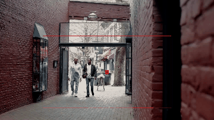

# dwell-vision

Measure how long people stay inside a zone of a video, built on Roboflow's open-source
[`supervision`](https://github.com/roboflow/supervision). No API key needed.

**Pipeline:** detect people, track with ByteTrack, check PolygonZone membership, accumulate per-person dwell time.

## Run
```bash
pip install -r requirements.txt
python app.py --source in.mp4 --target out.mp4
# optional custom zone: --zone 100,300 700,300 700,650 100,650
# optional Roboflow backend: --backend roboflow (needs ROBOFLOW_API_KEY)
```

## Test
```bash
pytest
```
The dwell logic (`dwell/tracker.py`) is model-free, so tests run instantly.

## Ideas
- CSV/JSON export, FastAPI + React dashboard, multiple zones, average-dwell alerts.


